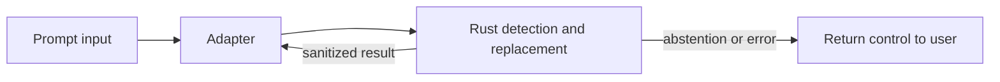

# Contributing to craig

Bug reports, design proposals, documentation corrections, tests, and code are
welcome. Start with an issue so contributors and maintainers agree on the
problem before implementing a change.

## Issue acceptance

Search [open and closed issues](https://github.com/yourmoodai/craig/issues?q=is%3Aissue)
before opening a proposal. Describe the problem, proposed behavior, a small
example, and effects on privacy, latency, compatibility, or model quality.

Community implementation starts when the maintainer applies `status: accepted`
or explicitly says the issue is ready for implementation. Acknowledgment,
questions, and ongoing design discussion are not acceptance. Issues labeled
`good first issue` or `help wanted` are accepted unless a maintainer says
otherwise. This also applies to small documentation changes.

Changes authored by [@awill1988](https://github.com/awill1988) are exempt from
issue acceptance because the maintainer supplies the prioritization directly.
The same technical and verification standards apply. An early community PR
may be closed and redirected to an issue; it can be reopened after acceptance.

## Maintainer commitments

The maintainer will acknowledge issues and initially review eligible PRs within
seven calendar days. Responses will state whether a proposal is accepted,
needs information or design discussion, duplicates existing work, or falls
outside the project's direction. Declined proposals receive a reason, and
blocked reviews receive a status update. Feedback stays specific and respectful.

Acknowledgment does not guarantee acceptance or merging. If seven days pass
without a response, one follow-up on the issue or PR is welcome.

## Design constraints

Craig favors a narrow, inspectable boundary over a convenient fallback: prompt
input is transformed locally, unchanged text remains exact, and a processing
failure returns control to the user rather than submitting its original.



- Detection, source offsets, protection checks, and replacement belong in Rust.
  JavaScript and agent adapters transport requests and results.
- Runtime inference stays local and offline. Downloads require explicit setup.
  Never log or persist original prompts, or use private history as training data.
- Preserve unmatched text exactly. Protected or failed replacements return
  control to the user; never submit the original as a fallback.
- Keep input coverage intact when measuring speed. Report resident rewriting,
  process startup, host interaction, and optional judging separately.
- Separate replacement correctness, reference-label agreement, and model
  agreement. Keep provisional labels visible. Policy evaluation is measured
  policy alignment, not certification or provider approval.

Discuss model changes, public interfaces, supported agents, dependencies,
licensing, and release behavior in the accepted issue.
[ADR 1](docs/adr/0001-local-span-replacement.md) owns the replacement boundary,
[ADR 2](docs/adr/0002-release-and-quality-evidence.md) owns release and evidence
gates, and [ADR 3](docs/adr/0003-future-egress-enforcement.md) owns the planned
transparent-proxy adapter and separate unproven enforcement question. New
implementation phases do not automatically need new ADRs.

## Architecture records

ADRs describe enduring boundaries, not implementation logs. Keep their language
visual and audience-first; put commands, thresholds, and mechanical procedure
in the relevant benchmark, release, or tool guide.

`.github/CODEOWNERS` explicitly assigns `docs/adr/**` to the maintainer. A
repository administrator must enable GitHub's **Require review from Code
Owners** branch-protection rule for protected branches; the file requests a
review but cannot enforce it by itself. ADR changes should not be merged through
an ordinary-contributor bypass.

## Development

Work on a focused branch in your fork. Source development requires Rust, a
C/C++ toolchain, and Node.js 22.18 or newer. Build the Rust library and typed
Node bindings before exercising the adapter.

```sh
npm ci
npm run build
npm run model:fetch
export CRAIG_MODEL_DIR="$PWD/.cache/models/mudes-en-base"
node bridge/cli.mjs doctor
claude --plugin-dir "$PWD"
npm run verify
```

Model changes additionally require `npm run eval:local` and reference parity.
[Evaluation](docs/evaluation.md) explains the claim boundary;
[benchmarking](docs/benchmarking.md) owns the detailed quality and performance
procedure. Shared CI hardware does not qualify latency. An installed-host test
is separate from adapter unit tests; state explicitly when it cannot run.

Add focused tests for changed behavior. Update documentation for changed
interfaces and contributor workflows. Test and profiling data must be synthetic
or explicitly licensed for that purpose.

## Commit messages and hooks

Use lowercase Conventional Commit subjects, optionally preceded by a ticket
such as `[PROJ-123]`. Subjects must fit within 50 characters and have no trailing
period; wrap bodies at 72 characters. Do not add generated attribution,
co-author footers, or tool signatures.

The Rust [commit checker](tools/commit_check/README.md) runs in CI and is
available through `.githooks/commit-msg`. Before configuring hooks, inspect the
existing path:

```sh
git config --get core.hooksPath
```

If no path is configured, activate the repository hooks with
`git config core.hooksPath .githooks`. If a developer profile already manages
hooks, preserve its signing, routing, and push checks. Use the checker directly
or integrate it through that profile's supported hook mechanism; do not replace
the configured path merely to install these hooks.

Existing published bootstrap commits predate commit-format enforcement. New
commits and PR titles are checked without rewriting that history.

## Pull requests

Link the accepted issue when required. Describe the resulting behavior,
affected modules and adapters, verification, limitations, and manual steps.
Use a conventional lowercase PR title. Keep review updates in new commits;
do not rewrite shared history. Green CI is required but does not replace
maintainer review or the model-promotion gates.

## Licensing

Submit only material you have the right to contribute. Contributions use the
project's existing [LICENSE](LICENSE) and [NOTICE](NOTICE) terms. Model weights
and imported tooling retain their separate licenses; keep their provenance and
notices intact. Synthetic fixtures use `CC0-1.0` where declared.


## Release and review workflows

[ADR 2](docs/adr/0002-release-and-quality-evidence.md) owns release packaging,
activation, and qualification. Run `python3 scripts/release/package.py stage`
with a supported target and output directory after a release build. CI assembles
all targets, exercises the archive, and gates tag publication on installed-host
tests. The generated release marketplace points at a checksummed ZIP; never
point it at an unqualified candidate. Source archives are not installable
release bundles.

The `adversarial verdict` CI job and its review limits are documented in the
[reviewer guide](tools/adversarial_reviewer/README.md). Existing required human
reviews and stale-review dismissal remain in effect. Authentication uses
short-lived AWS credentials through GitHub OIDC; do not copy credentials into
CI.
