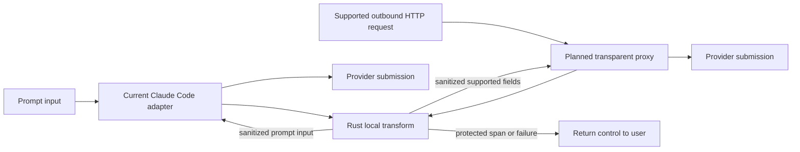

# 1. User-controlled prompt boundary

Date: 2026-10-12

## Status

Accepted. Craig's local transformation core is the product boundary. The Claude
Code mod is the current adapter; a transparent proxy is the planned next adapter.
Release evidence belongs to [ADR 2](0002-release-and-quality-evidence.md).
The blanket persistence prohibition below is superseded only for explicitly
consented local inspection by [ADR 4](0004-consented-local-traces.md).

## Terms

- **Prompt box** is the text-entry area where a user types and edits a prompt
  before pressing Enter. Claude Code's API calls this the `composer`.
- **Draft** is the unsent text currently in the prompt box.
- **Prompt input** is user-authored material prepared for an AI request.
- **Submission** is the request a provider receives after local processing.
- **Adapter** connects a host or transport to Craig's Rust core.
- **Local transformation** is the user-directed replacement of selected text
  before submission.

## What Craig controls

Craig gives a user a local choice about prompt input. When an adapter runs, the
provider receives the transformed submission or receives nothing from that
attempt. Craig does not claim authority over a host, a provider's terms, or an
unsubmitted draft outside its own process.

## Decision

- Rust owns detection, span normalization, protected-text checks, replacement,
  and content-free errors. Adapters translate host or transport requests; they
  do not reproduce text semantics.
- A successful adapter forwards transformed content only. A protected span,
  malformed request, incompatible artifact, or processing failure does not
  create an original-text fallback.
- Runtime inference is local and offline. Original prompts are not logged,
  persisted, put in errors, or used as training data.
- Adapter choice is replaceable. The current Claude Code mod supplies one
  submission path; the planned proxy supplies a transport-level path. Neither
  changes the Rust core's contract.

## Limits

The classifier can miss text or select harmless text. The current host may
disable or bypass its adapter, and the planned proxy is not yet implemented.
Those facts limit what Craig can claim about delivery, without changing the
user's local-control intent.

## Consequence

This design favors a visible interruption over a convenient leak. It also keeps
the user-facing promise independent of a particular AI client: new adapters must
preserve the same local-transform and no-original-fallback behavior.

## Open questions

- Which host and transport adapters can preserve this contract without becoming
  a permanent dependency on one AI product?
- Which reviewed evidence would support stronger detection-quality claims?
- Can independent egress control prevent bypasses across platform failures?
  That remains a separate question in ADR 3.

## Policy

AI enthusiasm should not turn a local tool into an authority by implication.
Prompt input has meaning in a user's context, and local transformation is a
user-directed choice. This record names both that choice and the systems it
cannot control.
