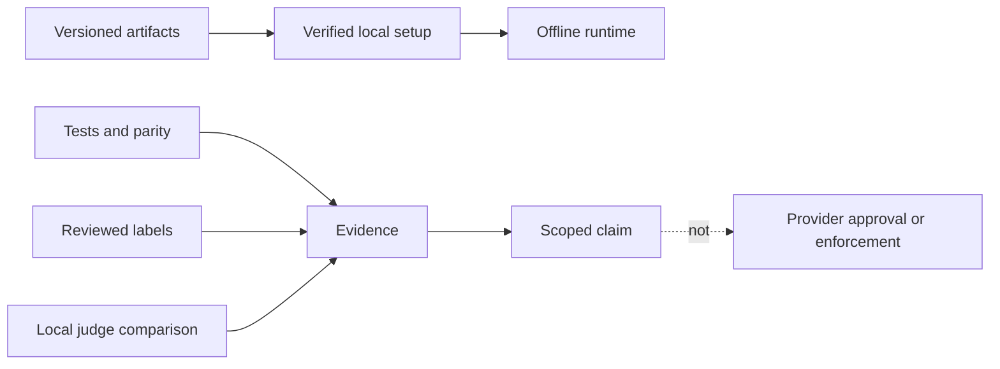

# 2. Release integrity and quality evidence

Date: 2026-10-20

## Status

Accepted for release qualification and default promotion. It does not promote a
model, backend, or judge by describing it.

## The claim path

A release and a quality claim both need a visible provenance trail. The project
does not compress artifact integrity, exact replacement behavior, reviewed
labels, and model agreement into one reassuring score.

## Decision

- Releases are versioned, immutable bundles. Models are separately pinned and
  verified on setup; runtime inference has no network client.
- Exact replacement and protected-span behavior are deterministic checks.
  Reference-label agreement depends on the corpus. Judge agreement describes
  judges, not ground truth.
- A new default requires complete evidence for its relevant safety, parity,
  quality, and performance gates. Missing or uncertain evidence holds the
  existing default.
- Policy work is reported as **measured policy alignment**. It is not
  certification, provider approval, or an enforcement guarantee.

## Consequence

A fast experiment, a successful package, or agreement between models may be
useful evidence, but none is enough on its own. Detailed commands, thresholds,
corpora, and benchmark reports live in [benchmarking](../benchmarking.md);
release operation lives in [contributing](../../CONTRIBUTING.md).

## Open questions

- What reviewed corpus can support a promotion claim beyond provisional labels?
- Which backends can satisfy both behavioral parity and full-input performance?
- What installed-host coverage is needed before a release is qualified?

## Policy

Evidence is contextual: a number without its corpus, machine, and comparison
does not say what readers may assume it says. Claims remain scoped to the
conditions that produced them.
