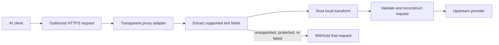

# 3. Planned transparent-proxy adapter

Date: 2026-10-20

## Status

Planned next adapter. It is not implemented, supported, or evidence of complete
egress enforcement.

## Purpose

A transparent HTTP proxy would apply Savior's local transformation at the
outbound request boundary instead of relying on a host-specific integration.
It would let a supported AI client keep its own interface while the proxy
extracts supported prompt fields, transforms them in Rust, and reconstructs the
request before forwarding it.

## Adapter contract

The proxy owns TLS termination and upstream validation, HTTP structure,
compression, framing, streaming behavior, routing, certificates, and operating
system lifecycle. Rust continues to own detection, offsets, protection, and
replacement. The proxy must preserve supported non-text fields and never apply
source offsets to serialized HTTP or JSON bytes.

A client or protocol the proxy cannot safely interpret is not a transformed
request. Compatibility must be demonstrated with actual clients, not inferred
from a generic HTTP test.

## Maintenance cost

This adapter is harder to maintain than a host integration. It must track
provider request formats, HTTP/1.1 and HTTP/2 behavior, streaming, certificate
trust, proxy and routing changes, QUIC or opaque traffic, platform privileges,
and operating-system updates. A failure in any of these layers must be visible;
it cannot become a silent original-text retry.

## Enforcement remains separate

Interception is not proof that all routes are intercepted. A stronger
fail-closed egress claim would additionally need independent bypass resistance,
authenticated privileged control, lifecycle containment, and platform-native
testing. Until that evidence exists, Savior may describe a proxy as a planned
adapter—not as universal network protection.

## Evidence before support

- Synthetic canaries and an independently controlled upstream receiver must
  show that supported requests arrive transformed.
- Real-client tests must cover request fidelity, TLS, compression, streaming,
  errors, retries, and redirects.
- Each advertised platform must demonstrate its proxy lifecycle, certificate
  handling, and failure behavior. Bypass resistance remains a separate gate.

## Policy

Transport is not neutral: routes, adapters, and institutions decide which
choices are visible to users. A proxy makes one route explicit; it does not
erase the surrounding technical or institutional constraints.
