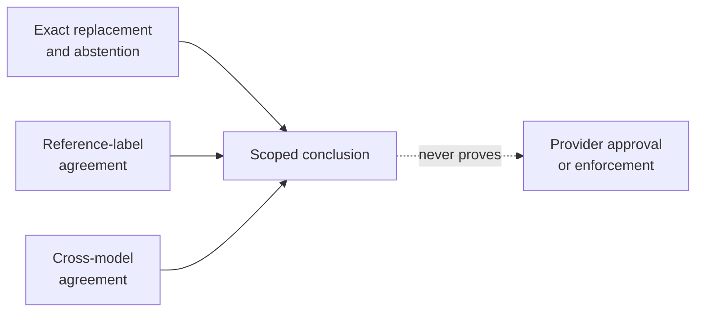
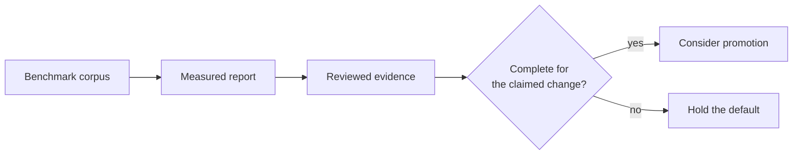

# Evaluation

Craig reports what it measured and what remains unknown. It does not use one
number—or one model's opinion—to claim safety, provider approval, or
enforcement.

## Read the results by type

| Evidence | Supports | Does not support |
| --- | --- | --- |
| Exact-output and parity checks | Replacement behavior | Detection coverage |
| Reviewed labels | Agreement with that corpus | General accuracy |
| Local judge comparison | Agreement between judges | Ground truth or certification |
| Installed-host test | Observed current-adapter path | Absence of every host bypass |

This distinction is intentional. A classifier may be wrong while replacement
still preserves unmatched text exactly. Judges may agree while a reference
replacement is still wrong. Missing, refused, malformed, or uncertain judgments
remain unresolved.

## Current position

- The default detector remains local CPU FP32. Its social-media training does
  not establish accuracy for developer prompts, other languages, or all context.
- Lexical and accelerated backends remain experimental until their applicable
  parity, quality, and performance evidence is complete.
- Provider-policy work uses **measured policy alignment**. Provisional labels
  and uncalibrated judges produce `inconclusive`, not a passing claim.
- Personal review is opt-in and does not change the successful replacement path.
  It stores only permitted numeric/categorical metrics and provenance.

## Where to reproduce and inspect detail

[Benchmarking Craig](benchmarking.md) owns corpus provenance, benchmark commands,
performance protocols, and generated reports. [Contributing](../CONTRIBUTING.md)
owns developer setup and release procedure. The repository's tests, package
scripts, and tool guides are the implementation-level source of truth.

Run `npm run build` and `npm run verify` for implementation verification.
Model changes also require `npm run eval:local` and reference parity. Use new
output paths for benchmark evidence; never use private prompts in an evaluation,
profile, or report.

## Boundaries still unverified

- Synthetic and provisional labels do not estimate real-world precision, recall,
  provider-policy compliance, or judge calibration.
- The current Claude Code adapter cannot prove the absence of host telemetry,
  other plugin behavior, or voice uploads before local transformation.
- The transparent-proxy adapter is planned but unimplemented. It does not yet
  establish egress enforcement; see [ADR 3](adr/0003-future-egress-enforcement.md).

For the architectural claim boundaries, see
[ADR 1](adr/0001-local-span-replacement.md) and
[ADR 2](adr/0002-release-and-quality-evidence.md).
