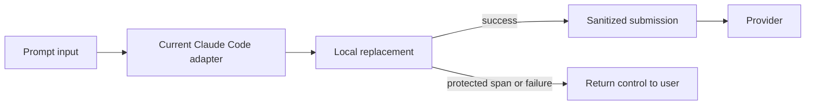
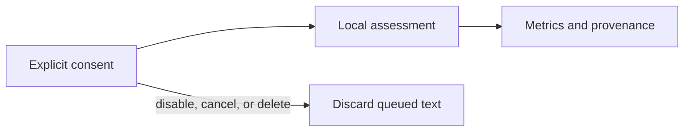

# Advanced usage

For installation, see the [README](../README.md). For source development, see
[CONTRIBUTING](../CONTRIBUTING.md#development).

## What happens to prompt input

The **prompt box** is where you type and edit a prompt before pressing Enter.
The unsent text in that box is your **draft**. Craig calls the user-authored
material it processes **prompt input**, whether it comes from that box or
another adapter.

Craig gives users local control over prompt input before a provider submission.
It is not a claim that every phrase will be recognized or that the host is
private. When the current adapter processes an input successfully, only the
replacement reaches the provider. When it cannot, the prompt input remains
available to the user.

The Claude Code mod is the current adapter, not the architecture's permanent
center. `/craig` opens its local inspection pane for the latest original and
replacement; it does not add them to model context and clears its inspection
data with the session. A transparent HTTP proxy is the planned next adapter;
it is not yet available or proof that every network path is controlled. See
[ADR 3](adr/0003-future-egress-enforcement.md).

## Configuration

Set these variables before starting Claude.

| Variable | Meaning |
| --- | --- |
| `CRAIG_DETECTOR` | `bert` by default; `lexical` is an explicit experimental choice |
| `CRAIG_MODEL_DIR` | Optional absolute model path |
| `CRAIG_THRESHOLD` | Optional threshold, greater than zero and at most one |
| `CRAIG_POLICY` | `offensive_spans` by default; `directed_abuse` needs a matching head |
| `CRAIG_REPLACEMENT` | Marker text; default `ya ya ya` |
| `CRAIG_JUDGE_CONFIG` | Optional prepared local `judge.json` after review is enabled |
| `LOG_LEVEL` | `silent` suppresses diagnostic error codes |

Invalid settings fail explicitly. They do not fall back to another detector or
forward the original request.

## Personal review

Personal review is off until enabled in `/craig`. The current adapter's live
metrics observe processed prompt input; history access starts an explicit scan
of the active `CLAUDE_CONFIG_DIR` profile. Sampling is local and bounded. A
missing judge leaves an observation unresolved; it never becomes a passing
result.

The metrics store contains counts, proportions, confidence, categorical
judgments, and provenance hashes—not originals, replacements, excerpts, titles,
or judge explanations. It is owner-only and retained for 30 days. Exported files
are user-managed copies. History does not prove authorship or recover an
original that was replaced before submission.

For personal-review evidence and interpretation, see
[evaluation](evaluation.md). For implementation commands and test coverage, see
[benchmarking](benchmarking.md).

## Library and CLI contract

Generated TypeScript declarations are in `native/index.d.ts` after building.
Rust offsets use UTF-8 bytes; JavaScript offsets use UTF-16 units.
`detect` applies configured protection and threshold rules, while
`applyReplacements` validates and normalizes supplied spans. A detector allows
one queued or running inference; concurrent calls fail with `busy`.

The CLI and Node bridge receive versioned JSON on stdin. Success returns
`version`, `status`, `text`, and `replacement_count`; errors return a
content-free `code` and exit nonzero. Do not pass private prompts in process
arguments.

## Limits

Craig does not log or persist prompts, send them to a remote detector, or use an
original-text fallback. The current host can still bypass its adapter, and Craig
cannot prove that Claude Code, another plugin, crash reporting, terminal
capture, or voice dictation has not exposed text. It may miss unwanted language
or select harmless language. Protected code, quotations, paths, URLs, and
technical literals return control to the user instead of being silently
rewritten.

See [ADR 1](adr/0001-local-span-replacement.md) for the user-controlled prompt
boundary and [ADR 3](adr/0003-future-egress-enforcement.md) for the planned
transparent-proxy adapter.

## License, attribution, and forks

Craig is licensed under the **GNU Affero General Public License v3.0 or later**
([`AGPL-3.0-or-later`](../LICENSE)). Copies and forks must retain
[`LICENSE`](../LICENSE) and [`NOTICE`](../NOTICE), credit Adam Williams and
`yourmood.ai` with `https://github.com/yourmoodai/craig`, use a distinct
plugin `name` and `displayName` when distributed, and publish complete
Corresponding Source under `AGPL-3.0-or-later`.

Model weights remain separate Apache-2.0 artifacts. Their provenance and notices
are in [`models/catalog.json`](../models/catalog.json) and
[`models/NOTICE`](../models/NOTICE).
